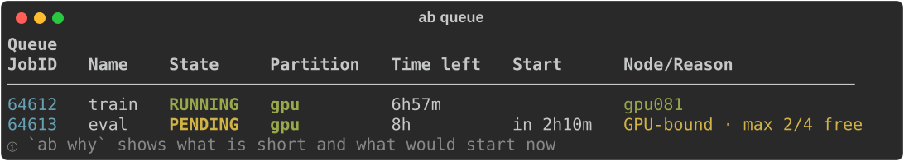
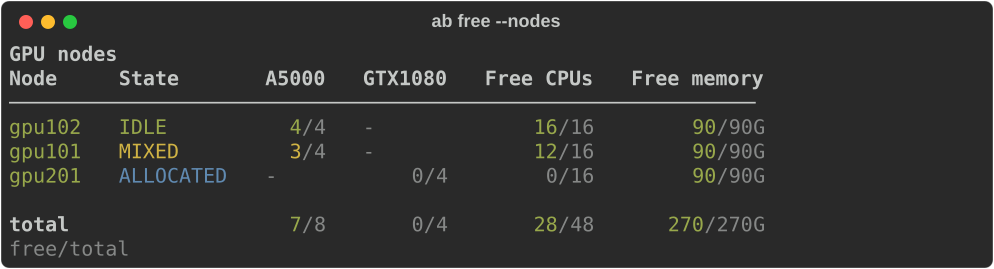

# allegro-buddy

A small Slurm companion for everyday cluster work: what is free, why your job is
waiting, and a dev node in one command. It reads what it needs from Slurm, so it
works beyond the Allegro cluster it was born on.

allegro-buddy is now written in Rust: same commands, flags, config and output as
before, it just starts much faster.



## Install

```bash
uv tool install allegro-buddy          # or: pip install allegro-buddy
ab completion --install                # optional: tab completion
```

This installs two equal commands, `ab` and `allegro-buddy`. Upgrade with
`uv tool upgrade allegro-buddy`.

## Commands

| Command | What it does |
| --- | --- |
| `ab info` | Partitions you can use, with free CPUs, memory and GPUs |
| `ab free [--nodes] [-G a5000]` | Free GPUs by type, per partition or per node |
| `ab q [--all] [-w]` | Your queue, with start estimates and what pending jobs lack |
| `ab why [JOBID] [--fix]` | Why a job waits, and the one change that starts it now |
| `ab node [NODE]` | Which jobs use a node's GPUs, CPUs and memory, and for how long |
| `ab dev start / login / status / stop` | A detached dev allocation; `ab l` logs in |
| `ab job history / output` | Your finished jobs and their output |
| `ab config show` | Every setting and where it came from |

Every command has `-h`.

### Why is my job waiting?


`ab why JOBID --fix` applies the suggested change after asking. It only touches
your own pending jobs and never lowers the GPU count unless you pass `--fix gpus`.

### What is free?



### Dev nodes

```bash
ab dev start --gpu 1 --gpu-type a5000   # waits until running, then shows how to log in
ab l                                    # ssh into it (--srun where SSH is blocked)
ab dev stop
```

## Configuration

Slurm tells allegro-buddy which partitions have GPUs, which GPU types exist and
which partition is the default. A config file only fills in the rest, such as
your own `ab dev start` defaults:

```ini
# ~/.config/allegro-buddy/config.ini
[dev]
gpu = 1
gpu-type = a5000
cpus = 8
mem = 32G
time = 04:00:00
```

Values come from, highest first: command-line flags, your user file, a site file
(`$AB_SITE_CONFIG` or `/etc/allegro-buddy/config.ini`), a shipped cluster preset
(`allegro`, `bhlrn4`), then Slurm. The preset follows Slurm's `ClusterName`;
`AB_CLUSTER=none` turns it off. `ab config show` lists every value and its source.

## License

MIT, see [LICENSE](https://github.com/Grutschus/allegro-buddy/blob/main/LICENSE).
