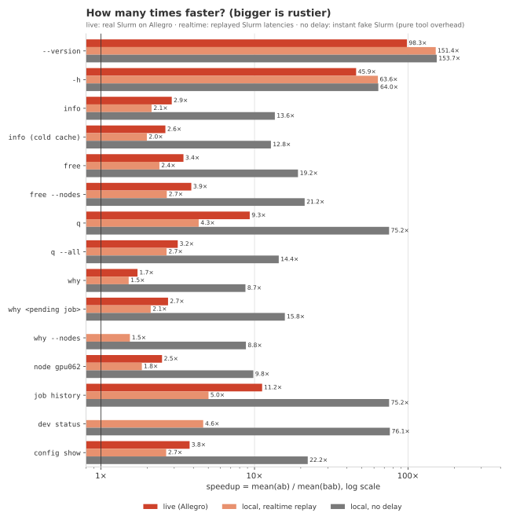
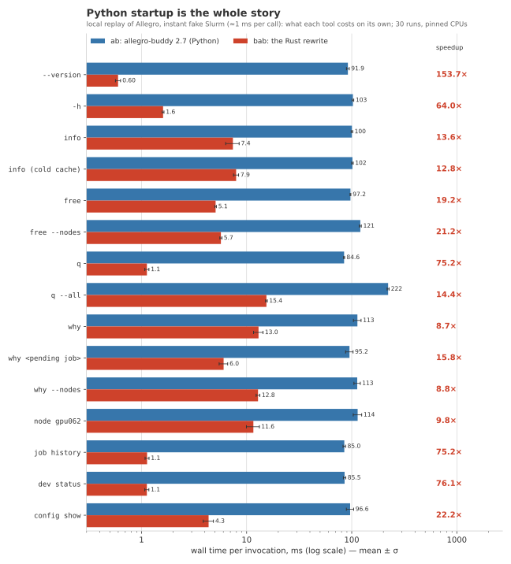

# better-allegro-buddy

**[allegro-buddy](https://github.com/Grutschus/allegro-buddy), rewritten in Rust.** Yes, really.

`bab` is a byte-for-byte compatible Rust rewrite of `ab`, the Python CLI
allegro-buddy 2.7 by [Grutschus](https://github.com/Grutschus): a small Slurm
companion for everyday cluster work. It tells you what is free, why your job is waiting,
and gets you a dev node in one command. It reads what it needs from Slurm, so it works
beyond the Allegro cluster it was born on.

The original is a great tool. Its only flaw: it is Python, so every call spends ~150 ms
importing itself before it asks Slurm anything. Rewriting things in Rust is a meme, so
we did it as a joke and gave it the most modest name we could think of. Then the joke
got a differential test harness, a benchmark suite and a CI pipeline. Now it is
**3.4× faster** (median, live on Allegro). Same commands, flags, config and output, down
to the last ANSI escape code. Only the name changed, and it got one more `b`.

<p align="center">
  <picture align="center">
    <source media="(prefers-color-scheme: dark)" srcset="bench/plots/hero-dark.svg">
    <source media="(prefers-color-scheme: light)" srcset="bench/plots/hero-light.svg">
    
  </picture>
</p>
<p align="center">
  <i>Running all 12 read-only commands once, live on the Allegro cluster. Same output, byte for byte.</i>
</p>

## Install

From PyPI, as a single prebuilt binary (Linux x86_64/aarch64 with glibc ≥ 2.17, macOS),
with [uv](https://docs.astral.sh/uv/):

```bash
uv tool install better-allegro-buddy
bab completion --install               # optional: tab completion
```

or `pipx install better-allegro-buddy`. Upgrade with `uv tool upgrade better-allegro-buddy`
(`pipx upgrade better-allegro-buddy`). Just trying it out?
`uvx --from better-allegro-buddy bab q` runs it without installing.

The package is `better-allegro-buddy` (the name `bab` was taken on PyPI); the command
is `bab`. `ab` and `bab` happily live side by side.

From source, with Rust ≥ 1.88 (e.g. via [rustup](https://rustup.rs)):

```bash
cargo install --locked --git https://github.com/plainerman/better-allegro-buddy
```

This puts `bab` into `~/.cargo/bin` (run it again to upgrade).

## Commands

| Command | What it does |
| --- | --- |
| `bab info` | Partitions you can use, with free CPUs, memory and GPUs |
| `bab free [--nodes] [-G a5000]` | Free GPUs by type, per partition or per node |
| `bab q [--all] [-w]` | Your queue, with start estimates and what pending jobs lack |
| `bab why [JOBID] [--fix]` | Why a job waits, and the one change that starts it now |
| `bab node [NODE]` | Which jobs use a node's GPUs, CPUs and memory, and for how long |
| `bab dev start / login / status / stop` | A detached dev allocation; `bab l` logs in |
| `bab job history / output` | Your finished jobs and their output |
| `bab config show` | Every setting and where it came from |

Every command has `-h`. It comes back in ~3 ms now, so you can afford to ask.

The screenshots below were taken with the original `ab`. We didn't redo them: apart
from the program name, `bab` prints exactly the same bytes. That's the whole point.


### Why is my job waiting?


`bab why JOBID --fix` applies the suggested change after asking. It only touches
your own pending jobs and never lowers the GPU count unless you pass `--fix gpus`.

### What is free?


### Dev nodes

```bash
bab dev start --gpu 1 --gpu-type a5000  # waits until running, then shows how to log in
bab l                                   # ssh into it (--srun where SSH is blocked)
bab dev stop
```

## Configuration

`bab` is a drop-in replacement. It reads the same config files and environment variables
as `ab`, shares its cluster-name cache, and names dev jobs `ab-dev` too. So
`bab dev status` finds the dev job you started with `ab dev start`, and vice versa.

Slurm tells it which partitions have GPUs, which GPU types exist and which partition is
the default. A config file only fills in the rest, such as your own `bab dev start`
defaults:

```ini
# ~/.config/allegro-buddy/config.ini
[dev]
gpu = 1
gpu-type = a5000
cpus = 8
mem = 32G
time = 04:00:00
```

Values come from, highest first: command-line flags, your user file, a site file
(`$AB_SITE_CONFIG` or `/etc/allegro-buddy/config.ini`), a shipped cluster preset
(`allegro`, `bhlrn4`), then Slurm. The preset follows Slurm's `ClusterName`;
`AB_CLUSTER=none` turns it off. `bab config show` lists every value and its source.

## Is it really identical?

"Byte-identical" is easy to say, so we tested it. A lot.

- **[`compat/`](compat/README.md)** runs **846 scenarios** (40 of them on a PTY)
  against `bab` and the pinned Python reference (allegro-buddy 2.7 from PyPI, exact
  click/rich/rich-click versions, renamed to `bab`), both on the same fake Slurm.
  Required to match: stdout and stderr (bytes, ANSI included), exit code, files written
  and Slurm calls (mutating ones in order). Covered: every `-h`, parsing errors,
  colours, widths, themes, `why --fix` prompts (yes, no, EOF), dev start/login/stop,
  `--watch` with Ctrl-C, completion, config layers, and job names full of Rich markup,
  emoji and wide characters.
- **Replay parity** ([`bench/`](bench/README.md)): real Allegro Slurm answers (Slurm
  24.11.5), recorded read-only, anonymised and replayed. 532 of 532 cases match: every
  recorded command × `COLUMNS` 80/160/200 × plain/`FORCE_COLOR`, with stdout, stderr,
  exit code and Slurm calls compared.
- **CI** runs `cargo fmt`, `clippy`, `cargo test` and the full compat suite on pushes
  and pull requests.

That includes the quirks. `bab --version` says `2.7`, not `2.7.0`. A job named
`[bold]x[/bold]` renders bold, because Rich would. The one thing we did not port is
Python's tracebacks: inputs that crash the original (e.g. `q -w nan`) are left out of
the tests on purpose.

## Performance

Live on Allegro (login node, Slurm 24.11.5, 194 jobs, 93 nodes, 10 runs each, mean
wall time):

| command | `ab` | `bab` | speedup |
| --- | ---: | ---: | ---: |
| `--version` | 146 ms | 1.5 ms | **98×** |
| `-h` | 161 ms | 3.5 ms | **46×** |
| `q` | 148 ms | 16 ms | **9.3×** |
| `q --all` | 571 ms | 181 ms | **3.2×** |
| `free` | 230 ms | 67 ms | **3.4×** |
| `info` | 255 ms | 88 ms | **2.9×** |
| `why` | 361 ms | 209 ms | **1.7×** |

Median over 13 commands: **3.4×** (geometric mean 5.7×); every call saves 130–390 ms.
Against an instant fake Slurm (pure tool overhead) the median is **19×**: `ab` needs
85–222 ms per command, `bab` 0.6–15 ms.

<p align="center">
  
</p>

| | |
| --- | --- |
|  |  |

Where it comes from: no interpreter start-up and imports (~145 ms of rich, rich-click
and click on Allegro's login node), parsing only the 28 job fields it actually reads,
and running independent read-only Slurm queries side by side.

Where it stops, honestly:

- **Slurm is the floor.** Rust doesn't make slurmctld answer any faster. `why` has to
  wait ~140 ms for `scontrol --json show job` and then ~50 ms for the nodes. The second
  call depends on the first one's result, and running both at once would change which
  calls happen when things fail (compat checks that too). So `why` "only" gets 1.7×.
- These numbers come from a quiet evening. Under daytime load Slurm takes longer; the
  absolute savings stay, but the ratios of Slurm-bound commands shrink.
- At ~0.2 s saved per call, the rewrite pays for itself after a few million `bab q`s.
  We're working on it.

Full tables, methodology and local replay numbers: [`bench/RESULTS.md`](bench/RESULTS.md).
The optimisation pass (what was tried, kept and rejected): [`bench/PERF.md`](bench/PERF.md).

## Development

Stable Rust ≥ 1.88 (edition 2024). The differential tests need
[uv](https://docs.astral.sh/uv/), which fetches the Python reference.

```bash
cargo test                                   # unit + integration tests (enables test-hooks)
cargo clippy --all-targets -- -D warnings

# compat: bab vs the Python reference; needs the BAB_TEST_* hooks (frozen clock, groups, host)
cargo build --release --features test-hooks
uv run --project compat compat/run.py check --bin target/release/bab
BAB_BIN=target/release/bab uv run --project compat pytest compat -q -n auto   # as in CI
```

A normal build never reads the `BAB_TEST_*` variables; ship that one. Replay parity,
recording on a cluster, benchmarks and plots (`uv run bench/plot.py`): see
[`bench/README.md`](bench/README.md).

### Releasing

Wheels (manylinux2014 x86_64/aarch64, macOS x86_64/arm64) and the sdist are built by
[`release.yml`](https://github.com/plainerman/better-allegro-buddy/blob/main/.github/workflows/release.yml)
with [maturin](https://www.maturin.rs) (`pyproject.toml`) on every push to `main` that
touches the code, and published to PyPI only for a `v*` tag.

One-time setup:

1. On PyPI: *Your account → Publishing → Add a new pending publisher* (GitHub):
   project `better-allegro-buddy`, owner `plainerman`, repository
   `better-allegro-buddy`, workflow `release.yml`, environment `pypi`.
2. On GitHub: *Settings → Environments → New environment* `pypi` (optionally with
   required reviewers and a `v*` tag rule).

Each release:

1. Bump `version` in `Cargo.toml` (and `VERSION_DISPLAY` in `src/lib.rs`, which is what
   `bab --version` prints), run `cargo check` to update `Cargo.lock`, merge into `main`.
2. Tag and push: `git tag vX.Y.Z && git push origin vX.Y.Z`. The tag must equal the
   `Cargo.toml` version; the workflow builds and checks all files, uploads them to PyPI
   (trusted publishing, no token) and attaches them to a GitHub release.

Locally: `uvx maturin build --release` (wheel for this machine), `uvx maturin sdist`.

## Credits and license

All the ideas, the UX and every word `bab` prints come from
[allegro-buddy](https://github.com/Grutschus/allegro-buddy) by
[Grutschus](https://github.com/Grutschus). This repository only made it rustier. If you
like `bab`, star the original. If you'd rather keep Python, use the original:
`uv tool install allegro-buddy`.

MIT, see [LICENSE](LICENSE). Copyright © 2026 Grutschus (allegro-buddy) and
© 2026 Michael Plainer (the Rust rewrite).
