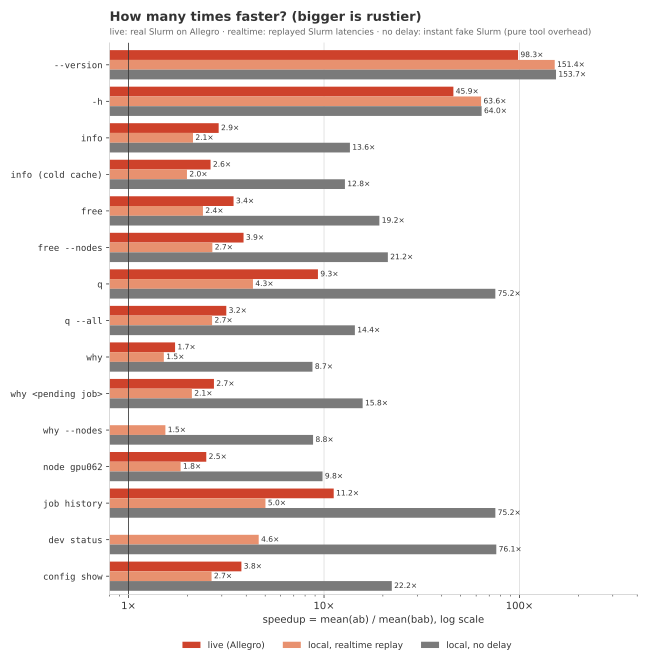
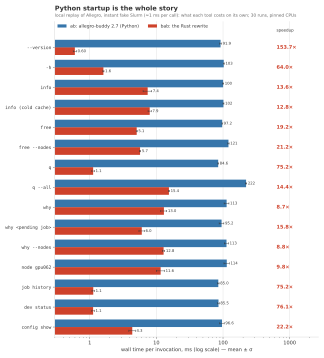
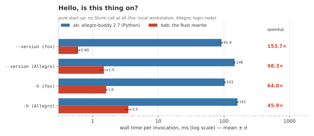

# ab vs bab: final performance comparison

Python `allegro-buddy` 2.7 (`ab`) vs its byte-identical Rust rewrite `bab` (2.7), every
read-only command, live on the Allegro cluster and locally on a replay of it.

## Summary (quote these)

> **Live on Allegro** (2026-11-04, 20:28 CET, real Slurm 24.11.5, 194 jobs, 93 nodes, 10 runs each):
> `bab` is **3.4× faster** than `ab` (median over 13 commands; geometric mean 5.7×).
> Every invocation saves **130–390 ms**. Commands that talk to Slurm: **1.7× (`why`) to
> 11.2× (`job history`)**, median 3.2×; e.g. `info` 255 → 88 ms, `free` 230 → 67 ms,
> `q` 148 → 16 ms, `q --all` 571 → 181 ms, `why` 361 → 209 ms.
> Pure start-up: `--version` **146 → 1.5 ms (98×)**, `-h` 161 → 3.5 ms (46×).
>
> **Local, instant fake Slurm** (pure tool overhead): median **19×**, from 8.7× (`why`)
> to 154× (`--version`); `ab` needs 85–222 ms per command, `bab` 0.6–15 ms.
> **Local, replayed Slurm latencies**: median 2.7× (1.5× `why` … 151× `--version`).
>
> **Cold vs warm cluster-name cache** (`info`): live `ab` 275 / 255 ms, `bab` 105 / 88 ms;
> both pay one extra `scontrol show config` (~17–21 ms) on a cold cache.
>
> Where it comes from: ~90–145 ms of Python start-up and imports (rich, rich-click,
> click) that `bab` does not have, faster parsing/rendering of big Slurm answers, and
> independent read-only Slurm queries run side by side. Where it stops: the slowest
> Slurm call. `why` must wait ~140 ms for `scontrol --json show job` of all jobs, so it
> "only" gets 1.7×.

A second live pass 11 minutes later (`results/live/live-20261104T203915`) agreed within
4 % on every ratio except `node` (2.6×, +6 %) and `--version` (114× instead of 98×: `bab`
1.29 vs 1.48 ms).

## Plots

| | |
|---|---|
|  |  |
|  |  |
|  | |

`plots/*.svg` and `*.png`: `live` (a), `local-nodelay` (b, log scale), `local-realtime`
(c), `startup` (d, `--version`/`-h` on fox and Allegro), `speedup` (all three settings).
Regenerate: `uv run bench/plot.py` (inline-pinned matplotlib).

## Live on Allegro

`results/live/live-20261104T202756/` (hyperfine JSON per command + `env.txt`):
login node `allegro` (2× Xeon E5-2690 v4, 56 threads, Linux 6.12, load average 0.35),
Slurm 24.11.5 with 194 jobs (2 pending) on 93 nodes, Wednesday 20:28–20:30 CET (evening,
quiet slurmctld; under daytime load both tools wait longer for Slurm, so the absolute
savings stay and the ratios of Slurm-bound commands shrink). `ab` = the console script
`venv/bin/allegro-buddy` of a private venv (system Python 3.13.5, allegro-buddy 2.7,
click 8.3.2, rich 15.0.0, rich-click 1.9.9), `bab` = release build without test hooks
(sha256 `ce642f99…`). Real clock, groups and host name, no user config, COLUMNS=160,
output to /dev/null. `why <pending job>` = 76833 (another user's pending job),
`node gpu062`. Speedup = mean(ab) / mean(bab).

| command | ab mean ± σ (ms) | ab min | bab mean ± σ (ms) | bab min | speedup |
|---|---:|---:|---:|---:|---:|
| `--version` | 145.6 ± 1.8 | 141.4 | 1.48 ± 0.20 | 1.28 | **98.3×** |
| `-h` | 160.6 ± 3.2 | 156.7 | 3.50 ± 0.32 | 3.22 | **45.9×** |
| `info` | 254.6 ± 4.4 | 246.1 | 88.06 ± 4.48 | 77.43 | **2.9×** |
| `info (cold cache)` | 275.3 ± 10.3 | 256.9 | 104.77 ± 4.04 | 99.60 | **2.6×** |
| `free` | 230.0 ± 8.9 | 218.0 | 66.77 ± 1.81 | 65.28 | **3.4×** |
| `free --nodes` | 267.2 ± 10.1 | 248.7 | 68.95 ± 2.15 | 66.40 | **3.9×** |
| `q` | 148.1 ± 3.0 | 141.8 | 15.91 ± 1.06 | 14.61 | **9.3×** |
| `q --all` | 571.0 ± 20.6 | 530.3 | 180.55 ± 4.40 | 173.20 | **3.2×** |
| `why` | 361.1 ± 8.3 | 352.7 | 208.74 ± 1.81 | 205.73 | **1.7×** |
| `why <pending job>` | 215.9 ± 4.5 | 210.2 | 78.95 ± 3.82 | 74.53 | **2.7×** |
| `node gpu062` | 255.6 ± 13.2 | 239.5 | 102.32 ± 4.91 | 98.09 | **2.5×** |
| `job history` | 145.6 ± 2.2 | 142.9 | 12.99 ± 0.78 | 11.97 | **11.2×** |
| `config show` | 208.5 ± 3.1 | 204.8 | 55.17 ± 2.23 | 50.98 | **3.8×** |

## Local replay (fox)

`results/local/` (`env.txt`; `<setting>.json`: per command and tool n, mean, stddev,
median, min, max, mean CPU time, median peak RSS and every wall time; `<setting>.raw/`:
every hyperfine export). Workstation fox: Xeon W-1250P (6 cores/12 threads, 0.8–4.8 GHz,
governor `powersave`, not changeable), Linux 6.12, shared host (load ≈ 1), both tools
pinned to CPUs 4–7. `ab` = `venv/bin/ab` of a uv venv (Python 3.12.11, same pinned
packages as above, byte-compiled), `bab` = release build with `--features test-hooks`
(commit `e2077a9`, rustc 1.99.1). Data: the anonymised Allegro snapshot (225 jobs,
`scontrol --json show job` = 2.4 MB). 5 rounds × 6 runs = **30 runs** per command and
tool (+ 3 warmups per round), rounds rotate the tool order.

### No delay: every fake Slurm call is instant (~1 ms of `sh` + `cat`, same for both)

| command | ab mean ± σ (ms) | ab min | bab mean ± σ (ms) | bab min | speedup |
|---|---:|---:|---:|---:|---:|
| `--version` | 91.9 ± 2.8 | 90.6 | 0.60 ± 0.03 | 0.54 | **153.7×** |
| `-h` | 102.6 ± 1.9 | 100.7 | 1.60 ± 0.03 | 1.55 | **64.0×** |
| `info` | 100.4 ± 1.7 | 99.3 | 7.40 ± 1.09 | 6.37 | **13.6×** |
| `info (cold cache)` | 101.6 ± 1.7 | 99.3 | 7.94 ± 0.44 | 7.44 | **12.8×** |
| `free` | 97.2 ± 0.8 | 95.9 | 5.07 ± 0.09 | 4.92 | **19.2×** |
| `free --nodes` | 120.7 ± 2.7 | 119.1 | 5.69 ± 0.13 | 5.47 | **21.2×** |
| `q` | 84.6 ± 1.0 | 83.5 | 1.12 ± 0.05 | 1.03 | **75.2×** |
| `q --all` | 221.9 ± 4.6 | 218.0 | 15.43 ± 0.30 | 14.94 | **14.4×** |
| `why` | 113.2 ± 9.4 | 107.9 | 12.98 ± 1.34 | 12.19 | **8.7×** |
| `why <pending job>` | 95.2 ± 7.8 | 91.6 | 6.04 ± 0.56 | 5.55 | **15.8×** |
| `why --nodes` | 112.8 ± 7.8 | 108.0 | 12.83 ± 0.52 | 12.13 | **8.8×** |
| `node gpu062` | 113.8 ± 10.5 | 106.2 | 11.59 ± 1.63 | 9.69 | **9.8×** |
| `job history` | 85.0 ± 2.3 | 83.6 | 1.13 ± 0.05 | 1.04 | **75.2×** |
| `dev status` | 85.5 ± 2.2 | 83.9 | 1.12 ± 0.05 | 1.04 | **76.1×** |
| `config show` | 96.6 ± 7.6 | 93.3 | 4.35 ± 0.48 | 3.82 | **22.2×** |

`bab`'s own CPU time (user + sys) is 0.55 ms (`--version`) to 18 ms (`q --all`), `ab`'s
85–222 ms; peak RSS `ab` 23–32 MiB, `bab` 3.6–10 MiB.

### Realtime: every fake Slurm call sleeps as long as it took on Allegro when recorded

| command | ab mean ± σ (ms) | ab min | bab mean ± σ (ms) | bab min | speedup |
|---|---:|---:|---:|---:|---:|
| `--version` | 91.1 ± 0.3 | 90.3 | 0.60 ± 0.05 | 0.54 | **151.4×** |
| `-h` | 102.2 ± 0.4 | 101.3 | 1.61 ± 0.03 | 1.55 | **63.6×** |
| `info` | 287.3 ± 12.8 | 254.6 | 134.45 ± 7.07 | 122.16 | **2.1×** |
| `info (cold cache)` | 304.2 ± 17.1 | 256.4 | 152.85 ± 10.01 | 134.72 | **2.0×** |
| `free` | 217.8 ± 10.2 | 194.1 | 90.66 ± 5.43 | 76.66 | **2.4×** |
| `free --nodes` | 235.4 ± 10.8 | 205.2 | 87.69 ± 5.72 | 75.26 | **2.7×** |
| `q` | 112.7 ± 1.9 | 109.3 | 26.02 ± 1.74 | 20.71 | **4.3×** |
| `q --all` | 524.0 ± 12.4 | 490.2 | 195.88 ± 12.74 | 180.23 | **2.7×** |
| `why` | 378.2 ± 10.7 | 346.6 | 249.57 ± 13.10 | 226.72 | **1.5×** |
| `why <pending job>` | 216.6 ± 11.0 | 182.5 | 102.69 ± 5.80 | 92.86 | **2.1×** |
| `why --nodes` | 381.3 ± 14.1 | 328.9 | 247.04 ± 14.98 | 213.72 | **1.5×** |
| `node gpu062` | 242.7 ± 8.5 | 213.3 | 131.42 ± 9.03 | 111.47 | **1.8×** |
| `job history` | 107.1 ± 1.6 | 103.6 | 21.36 ± 2.27 | 16.71 | **5.0×** |
| `dev status` | 109.7 ± 1.7 | 104.8 | 23.67 ± 2.07 | 18.82 | **4.6×** |
| `config show` | 207.1 ± 9.6 | 187.7 | 77.91 ± 3.17 | 68.36 | **2.7×** |

`info (cold cache)`: the cluster-name cache file is deleted before every run (hyperfine
`--prepare`); `ab` 304 vs 287 ms warm, `bab` 153 vs 134 ms warm (no delay: 101.6/100.4 and
7.9/7.4 ms).

### A user with pending jobs (`data/allegro/as-user-a`, realtime)

`q` and `job history` now fetch job details for hints / have real history:

| command | ab mean ± σ (ms) | ab min | bab mean ± σ (ms) | bab min | speedup |
|---|---:|---:|---:|---:|---:|
| `info` | 336.8 ± 10.1 | 312.0 | 192.86 ± 11.90 | 169.12 | **1.7×** |
| `free` | 217.1 ± 8.1 | 191.2 | 89.16 ± 5.27 | 76.25 | **2.4×** |
| `q` | 442.0 ± 13.3 | 406.5 | 204.68 ± 10.96 | 179.89 | **2.2×** |
| `q --all` | 529.2 ± 14.1 | 473.0 | 203.18 ± 14.12 | 182.38 | **2.6×** |
| `why` | 394.2 ± 11.1 | 370.1 | 252.90 ± 12.21 | 232.94 | **1.6×** |
| `why <pending job>` | 224.7 ± 11.4 | 196.5 | 110.15 ± 6.60 | 99.13 | **2.0×** |
| `why --nodes` | 389.6 ± 10.2 | 368.6 | 252.32 ± 14.00 | 222.89 | **1.5×** |
| `job history` | 193.7 ± 5.2 | 180.5 | 92.96 ± 8.29 | 73.61 | **2.1×** |
| `dev status` | 111.8 ± 3.7 | 108.3 | 24.61 ± 2.29 | 19.76 | **4.5×** |

(no delay: median 14×, 8.3× `why --nodes` … 76× `dev status`; table: `uv run bench/plot.py`.)

## Where the speedup comes from (and where it stops)

1. **Interpreter start-up and imports.** On fox (`results/local/startup-breakdown.json`):
   `python -c pass` 9.2 ms, `import click` 29 ms, `import rich_click` 38 ms,
   `import allegro_buddy.cli` 79 ms, `ab --version` 91 ms. `bab --version` is 0.6 ms (a
   native binary: no interpreter, no imports). Every `ab` command pays ~85–100 ms
   before it does anything; on Allegro's older, lower-clocked login node ~145 ms.
   That alone explains the 46–154× of `-h`/`--version` and most of the 130–390 ms saved
   per live command.
2. **Parsing and rendering.** Beyond start-up, `ab` spends ~130 ms on `q --all`
   (2.4 MB of job JSON, a 225-row table), `bab` 15 ms in total; `node` 22 vs 12 ms,
   `why` 21 vs 13 ms. `bab` only decodes the 28 job keys it reads (see `PERF.md`).
3. **Independent Slurm queries side by side.** `bab` runs read-only queries that `ab`
   always makes anyway concurrently (`free`: reservations + partitions; `config show`;
   the `q` hints; `info`'s sacctmgr + squeue) — never speculative extra calls, the call
   multiset is identical (replay parity). Realtime minus no-delay = time waiting for
   Slurm: `free` ab 121 ms vs bab 86 ms, `config show` 111 vs 74 ms.
4. **The floor is Slurm.** A command can't be faster than its slowest required call:
   `why` waits for `scontrol --json show job` (~140 ms live) and `scontrol --json show
   nodes` (~50 ms) one after the other (the second one is gated on the first one's
   result, so running them concurrently would change the call log in failure cases),
   hence 1.7× live / 1.5× replay. The live ratios of Slurm-bound commands are higher
   than the replay ones because Allegro's login node is slower than fox at Python
   start-up (145 vs 91 ms), and because the replayed latencies (recorded at 18:51, plus
   ~3 ms of `sleep` per call) were somewhat higher than what slurmctld answered during
   the live run (`info`: `bab` 134 ms replayed vs 88 ms live).

## Methodology and honesty notes

* **Same output.** The `bab` build used locally passes replay parity 532/532 (every
  recorded command × COLUMNS 80/160/200 × plain/`FORCE_COLOR`, stdout, stderr, exit code
  and Slurm call multiset vs the reference). The hooked `ab` console script reproduces
  the recorded reference output of all 64 replay cases modulo the program name (`ab`
  vs `bab`) and the work directory in `config show`.
* **Direct entry points, nothing else in the timed path.** hyperfine `-N` (no shell)
  executes `venv/bin/ab` resp. `bab` directly; no `uv run`, no wrapper script.
* **Frozen clock/groups/host for the replay** (`BAB_TEST_NOW`, `BAB_TEST_GROUPS`,
  `BAB_TEST_HOSTNAME`): `bab` reads them only in `--features test-hooks` builds; `ab`
  gets them from `replay/ab_bench_hooks.py`, loaded by a one-line `.pth` in the venv only
  when `BAB_TEST_NOW` is set. It patches `core.datetime.now`, `current_groups` and
  `socket.gethostname` after importing `allegro_buddy.cli` — which the console script
  imports next anyway (unlike `compat/reference.py`, which hashes and copies the package
  on every run: not used here). Measured cost (`results/local/hooks/`, 40 runs, both
  through `env`): `ab --version` 92.2 ± 1.0 ms without vs 92.5 ± 1.5 ms with hooks,
  `ab -h` 103.8 ± 8.2 vs 102.9 ± 2.1 ms; `bab` plain vs test-hooks build with hooks set:
  1.036 vs 1.031 ms (`--version`), 2.109 vs 2.134 ms (`-h`). Within noise on both sides.
  The live runs use no hooks at all.
* **Fake Slurm.** `replay/fake` (POSIX `sh`, a `case` on the exact argv, `cat` of the
  recorded output) costs ~1 ms per call, identical for both tools; `--realtime` adds the
  recorded duration of each call (+ ~3 ms of `sleep`). Commands with many Slurm calls
  are thus slightly penalised in "no delay" for both tools.
* **Noise.** fox's `powersave` governor lets unpinned medians of one binary move by up
  to 2× between rounds; pinned (taskset 4–7) and interleaved, A/A runs agree within
  ~5 %. Live: 10 runs + 1 warmup per tool and command, tool order alternating per
  command, 5 s pauses, two passes agreeing within 4 % on most ratios (see the summary). Means ± σ in the tables; minima
  for the optimists.
* **Memory.** hyperfine's peak RSS is the maximum over the whole process tree,
  including the Slurm clients: live `q --all` and `why` show ~50 MiB for *both* tools —
  that is `scontrol --json`, not `ab`/`bab`. The local no-delay numbers above are the
  tools' own.
* **Python versions differ** between fox (3.12.11, like `compat/`) and Allegro (system
  3.13.5); the comparison is always within one host.

## Reproduce

Local (≈ 10 min):

```sh
sh bench/replay/make_ab_venv.sh /path/to/ab-venv          # ab 2.7 + hooks (uv)
cargo build --release --features test-hooks && cp target/release/bab bab-hooks
cargo build --release && cp target/release/bab bab-plain
sh bench/run_local.sh /path/to/ab-venv bab-hooks bab-plain   # -> bench/results/local
```

Live (≈ 2 min of cluster time, read-only allowlist only; never `/usr/bin/ab`, which is
Apache Bench):

```sh
B=.local/share/bab-bench   # venv/ with allegro-buddy 2.7 as in README.md
scp bab-plain allegro:$B/bin/bab; scp "$(command -v hyperfine)" allegro:$B/bin/
scp bench/live/bench_live.sh allegro:$B/live/
ssh allegro "cd $B && timeout 900 sh live/bench_live.sh live-out/live-\$(date +%Y%m%dT%H%M%S)"
scp -r allegro:$B/live-out/live-... bench/results/live/
uv run bench/plot.py      # plots + the tables of this file
```
